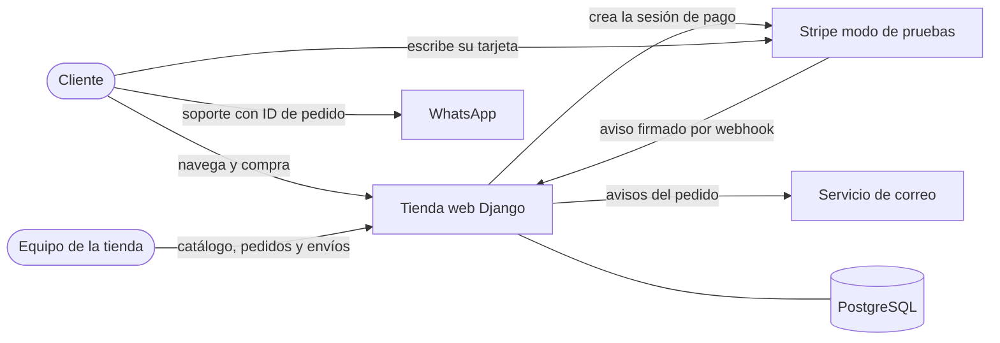
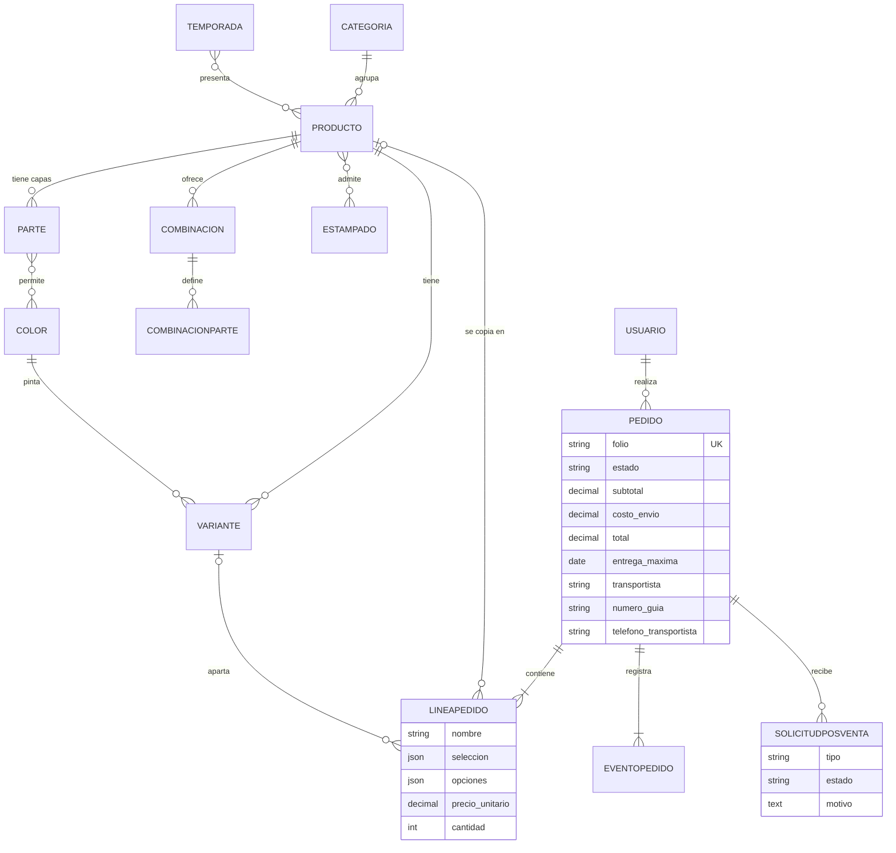
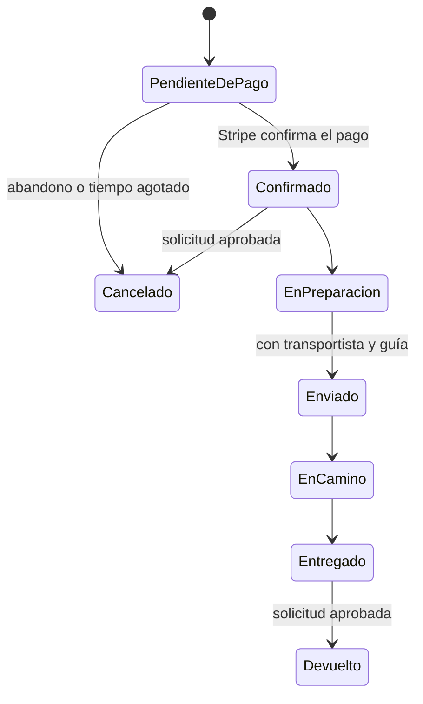
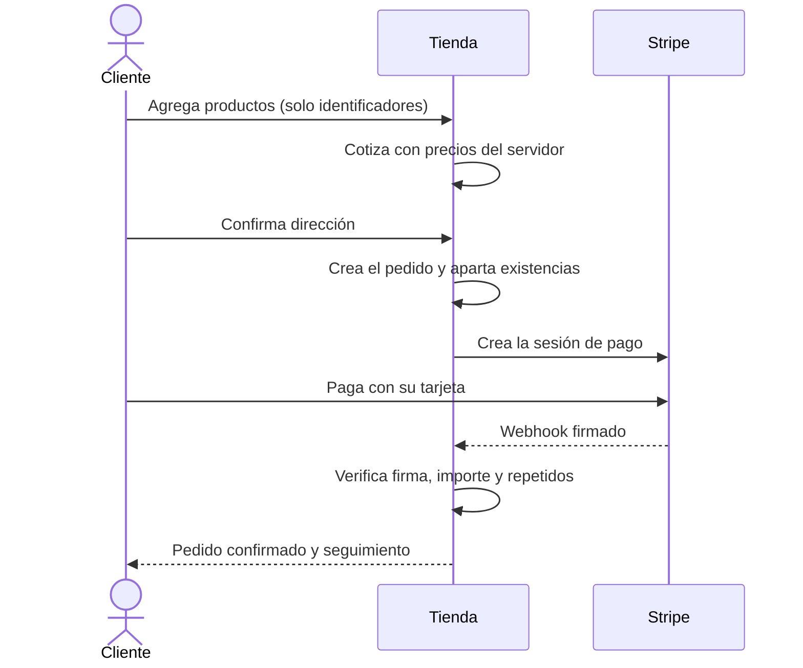

# Arquitectura de Pretexto

## Diagrama de contexto

## Capas

| Capa | Dónde vive | Responsabilidad |
|---|---|---|
| Interfaz | `templates/`, `static/` | HTML desde el servidor, CSS propio, simulador en canvas y HTMX |
| Lógica de negocio | `catalogo/cotizacion.py`, `catalogo/entregas.py`, `carrito/carrito.py`, `pedidos/servicios.py` | Precios, existencias, fechas, estados y reembolsos |
| Almacenamiento | `*/models.py` | SQLite en desarrollo y PostgreSQL en producción |

## Modelo de datos

`ConfiguracionTienda` guarda el costo de envío y los datos de soporte. `EventoPago` guarda los
avisos ya procesados de Stripe.

## Estados del pedido

## Recorrido de compra

## Decisiones técnicas

| Decisión | Por qué |
|---|---|
| Django con HTML desde el servidor | Es lo que promete el anteproyecto. Amazon, Apple, Huawei y Mercado Libre también envían el HTML armado |
| CSS propio en lugar de Bootstrap | Da la identidad visual buscada y evita cargar código que no se usa |
| HTMX | Actualiza el carrito sin recargar y sin una segunda aplicación en JavaScript |
| Carrito en sesión | Solo guarda selecciones; precios y existencias se recalculan siempre |
| Stripe Checkout | La tarjeta se captura en Stripe, así que nunca llega a este servidor |
| Webhook firmado y registro de eventos | El pago no depende de la pantalla del cliente y una confirmación repetida no se aplica dos veces |
| Existencias apartadas con una condición en el UPDATE | Dos compras simultáneas no pueden vender la última pieza |
| Lógica en `servicios.py` | Cliente, admin y Stripe pasan por las mismas reglas, y se pueden probar sin navegador |
| Folio aleatorio y 404 en pedidos ajenos | No revela cuántas ventas hay y no permite adivinar pedidos de otras personas |
| Sin recursos de terceros en el navegador | Permite una política de seguridad estricta y protege la privacidad |
